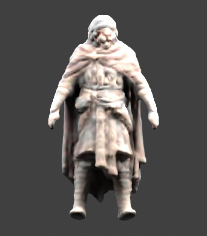
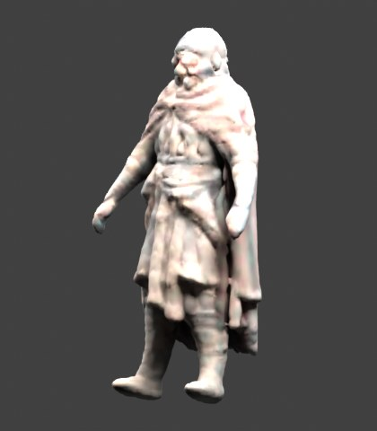
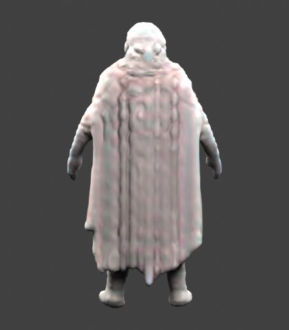
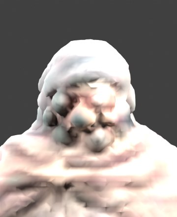
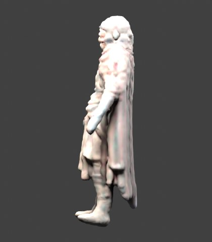
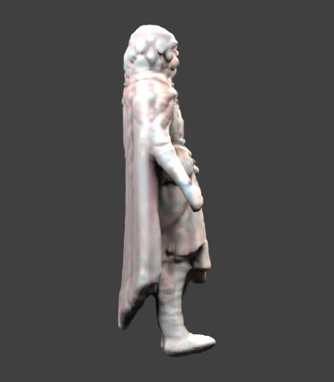
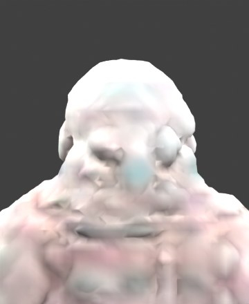

# CF-03 — контрольный эксперимент TripoSR

Фактические рендеры GLB из CI 45638519878. Художественная приёмка не пройдена: деформация лица, отсутствие детализации кистей, восковые складки, слабые материалы. 57712 треугольников, 1156144 байт, 83.29 с. Исходник 346×596, масштабирован до 1024×1024. Не игровая модель.

### front

### threequarter

### back

### face

### left

### right

### face_back

